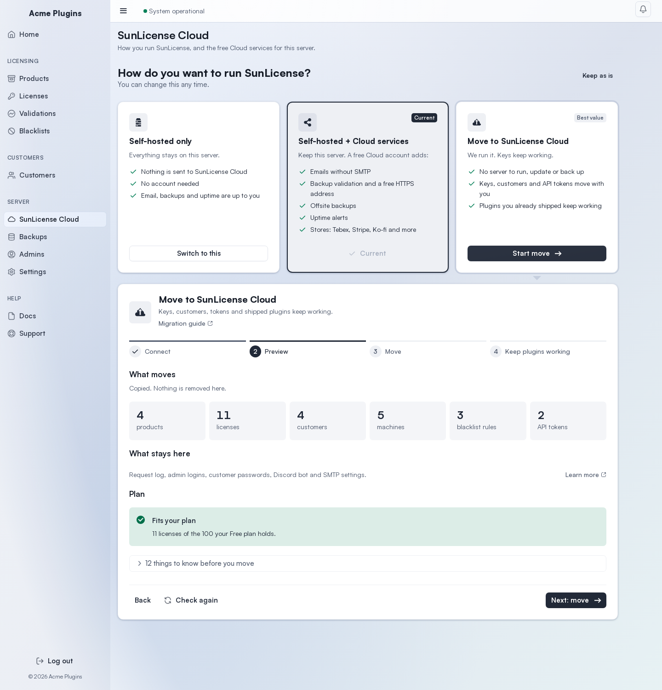

The **Move to SunLicense Cloud** wizard copies your products, licenses, customers and API tokens from your SunLicense server (1.4.0 or later) to SunLicense Cloud. Your keys keep working, and plugins you already shipped keep working while your server forwards them to Cloud. This page walks through the move and what to do before you turn your old server off.

<Frame caption="The move wizard's preview: what moves, what stays, and whether it fits your plan.">
  
</Frame>

## Before you start

- Update your server to SunLicense 1.4.0 or later.
- Make a backup on the **Backups** page.
- Have access to the email address you'll use for SunLicense Cloud. After the move you manage your licenses at [app.sunlicense.com](https://app.sunlicense.com), and signing in there needs a confirmed email, so the wizard waits for it.

## What moves and what stays

The move **copies** your data. Nothing is removed from your server.

| Moves to SunLicense Cloud | Stays on your server |
| --- | --- |
| Products | The request log. Cloud starts its own history. |
| Licenses and their keys | Admin accounts. You sign in to Cloud with your Cloud account. |
| Customers | Customer passwords. Buyers sign in to the Cloud customer portal with an email link. |
| Machines (HWIDs) | The Discord bot and SMTP settings. Cloud has its own Discord integration and sends emails itself. |
| Blacklist rules | API tokens that can't validate licenses. Cloud API keys only validate. |
| API tokens that validate licenses | |

The preview also lists anything specific to your data under **things to know before you move**. Read it before you continue.

## Run the move

<Steps>
  <Step title="Open the wizard">
    Click **Cloud** in the menu, then **Change**, and click **Start move** on **Move to SunLicense Cloud**.
  </Step>
  <Step title="Connect">
    Connect your server to the SunLicense Cloud organization it should move to: an account you have, or a new one. If the account's email isn't confirmed yet, confirm it and click **Check again**.
  </Step>
  <Step title="Preview">
    Your server builds the import and SunLicense Cloud tries it without saving anything. Check the counts, what stays, and **Plan**: whether your licenses fit your Cloud plan.
  </Step>
  <Step title="Move">
    Click **Move now**. Your server copies everything to Cloud, then checks 20 random keys answer the same in Cloud as on your server. The check doesn't use any of their IP or machine slots. Your server keeps running while it happens. Running the move again later adds only what's new.
  </Step>
  <Step title="Keep plugins working">
    Choose how plugins you already shipped reach Cloud. See the next section.
  </Step>
</Steps>

## Keep shipped plugins working

<Tabs>
  <Tab title="Forward from this server">
    **Recommended.** Plugins keep calling your server, and it passes every validation to SunLicense Cloud and returns Cloud's answer. Buyers change nothing. If Cloud can't be reached, your server answers itself as before.

    Click **Turn on forwarding and finish**. Before it switches, SunLicense checks every API token your plugins validate with is in Cloud. If one isn't, it stops and names the token, so no plugin starts failing.

    Keep your server running until your plugins call Cloud directly. See [Before you turn your server off](#before-you-turn-this-server-off).
  </Tab>
  <Tab title="Use the free HTTPS address">
    If your plugins already call your free address, such as `https://yourname.v1.sunlicense.com`, finish with it and SunLicense Cloud answers them itself. Your server no longer needs to run for them.

    No address yet? Pick one in the wizard or on the Cloud page, then ship a plugin update that calls it. See [Free HTTPS address](/sunlicense/cloud/services#free-https-address).
  </Tab>
  <Tab title="Point your domain at us">
    If your plugins call your own domain, for example `licenses.example.com`, SunDevs can answer on that domain. You change one DNS record and we set up the rest.

    Ask in the [SunDevs Discord](https://go.sundevs.net/discord) or through [support](/support) with the domain and your Cloud organization.
  </Tab>
  <Tab title="Ship an update">
    Release a plugin version that calls `https://api.sunlicense.com`. Code from **Settings › Plugin code** and the SunLicense Cloud SDKs generate it.
  </Tab>
</Tabs>

## After the move

- You manage products, licenses and customers in SunLicense Cloud. Editing on your server turns off, and it shows when it moved.
- Changes through your server's API (`/api/v2`) and the BuiltByBit webhook are refused with `409` and the message to make the change in SunLicense Cloud. Reads and validation keep working.
- Changed your mind? Click **Move back** on the SunLicense Cloud page. Editing turns on again on your server. Changes made in Cloud since the move aren't copied back.

## Before you turn this server off

Forwarding only works while your server runs. Once you turn it off, every plugin that still calls your server's address stops validating, and your buyers are locked out. Before you turn it off, make sure every plugin calls SunLicense Cloud.

<Warning>
  **Tell your buyers to replace the license server URL.** If your plugin reads the license server address from a config file, your buyers have to change it themselves. Announce the change well before you switch your server off, and tell them the exact new value.
</Warning>

<Steps>
  <Step title="Pick the new address">
    The simplest replacement is your [free HTTPS address](/sunlicense/cloud/services#free-https-address). It answers on the same paths with the same tokens and keys, for example `https://yourname.v1.sunlicense.com/api/v2/validate`.

    Plugins that call `/api/v2/validate` or `/api/v3/validate` with a token also work with `https://api.sunlicense.com`.
  </Step>
  <Step title="Tell your buyers">
    Post it where your buyers read: your Discord, your store page, and an email if you have one. For example:

    ```text Example announcement
    We've moved our license server to SunLicense Cloud.
    Before <date>, open plugins/<YourPlugin>/config.yml and change
      license-server: http://203.0.113.10:8080
    to
      license-server: https://yourname.v1.sunlicense.com
    then restart your server. Your license key stays the same.
    ```
  </Step>
  <Step title="Ship an update">
    Release a plugin version with the new address built in, for buyers who don't read announcements.
  </Step>
  <Step title="Give buyers time">
    Keep your server forwarding until the date you announced, so buyers who update late aren't locked out. Then turn it off.
  </Step>
</Steps>

<Tip>
  Plugins that call your own domain, such as `licenses.example.com`, don't need a URL change at all: [point your domain at us](#keep-shipped-plugins-working) instead.
</Tip>
