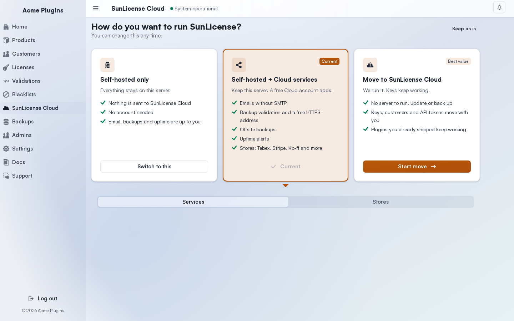

From version 1.4.0, your SunLicense server asks how you want to run it. You pick one of three ways on the **Cloud** page, and you can change it later. Nothing changes until you choose.

<Frame caption="SunLicense Cloud › Change shows the three ways to run SunLicense.">
  
</Frame>

## The three ways

<Columns cols={3}>
  <Card title="Self-hosted only" icon="server">
    Everything stays on your server. Nothing is sent to SunLicense Cloud and you need no account. Email, backups and uptime are up to you.
  </Card>
  <Card title="Self-hosted + Cloud services" icon="plug" href="/sunlicense/cloud/services">
    Keep your server and connect a free SunLicense Cloud account for emails without SMTP, offsite backups, backup validation, uptime alerts and stores.
  </Card>
  <Card title="Move to SunLicense Cloud" icon="cloud-arrow-up" href="/sunlicense/cloud/move-to-cloud">
    SunDevs runs it for you. Keys, customers and API tokens move with you, and plugins you already shipped keep working.
  </Card>
</Columns>

| | Self-hosted only | Self-hosted + Cloud services | Move to SunLicense Cloud |
| --- | --- | --- | --- |
| Where licenses live | Your server | Your server | SunLicense Cloud |
| Account needed | No | Free SunLicense Cloud account | SunLicense Cloud account |
| You run and update the server | Yes | Yes | No |
| Emails without your own mail server | No | Yes | Yes |
| Offsite backups and uptime alerts | No | Yes | Included in Cloud |
| Plugins you already shipped | Keep working | Keep working | Keep working |

## Pick or change your choice

<Steps>
  <Step title="Open the SunLicense Cloud page">
    In the dashboard menu, click **Cloud**. If you haven't chosen yet, the page shows the three cards. New and upgraded servers also show a one-time **How do you want to run SunLicense?** card on **Home**.
  </Step>
  <Step title="Choose a card">
    - **Self-hosted only**: click **Switch to this**.
    - **Self-hosted + Cloud services**: connect your server, then turn on the services you want. See [Cloud services](/sunlicense/cloud/services).
    - **Move to SunLicense Cloud**: click **Start move** and follow the wizard. See [Move to SunLicense Cloud](/sunlicense/cloud/move-to-cloud).
  </Step>
  <Step title="Change it later">
    Once you've chosen, the page shows one line such as **Running: Self-hosted + Cloud services**. Click **Change** to see the cards again. **Keep as is** closes them without changing anything.
  </Step>
</Steps>

<Note>
  Switching from **Self-hosted + Cloud services** to **Self-hosted only** disconnects your server. Cloud services stop, and nothing on your server changes. A server that moved to Cloud has to **Move back** first.
</Note>

## Related pages

<Columns cols={2}>
  <Card title="Cloud services" icon="plug" href="/sunlicense/cloud/services">
    What each free service does and how to turn it on.
  </Card>
  <Card title="Move to SunLicense Cloud" icon="cloud-arrow-up" href="/sunlicense/cloud/move-to-cloud">
    The move wizard, what moves, and how to keep plugins working.
  </Card>
</Columns>
