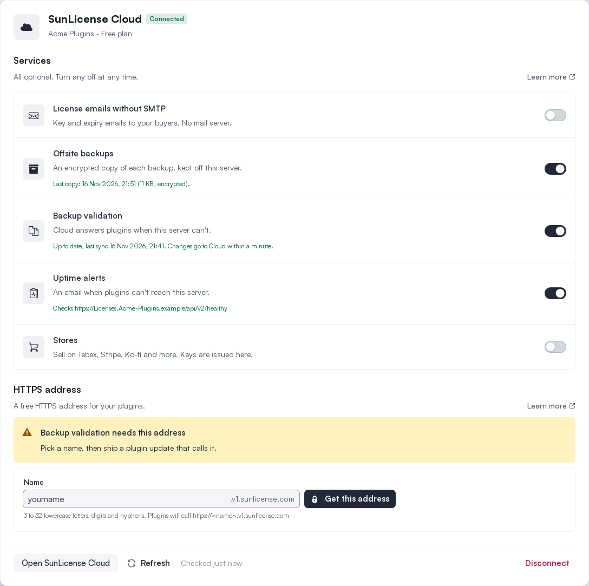
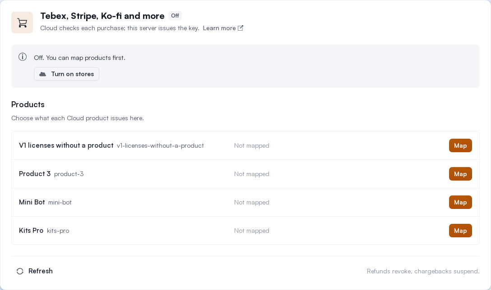
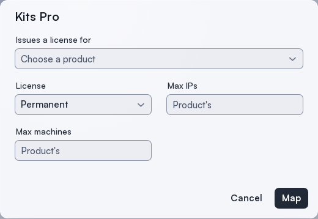

When you run SunLicense as **Self-hosted + Cloud services**, your licenses stay on your server and a free SunLicense Cloud account adds the things a single server can't do well alone. Every service is optional, and you can turn each one off again at any time.

<Frame caption="SunLicense Cloud › Services on a connected server.">
  
</Frame>

## Connect your server

<Steps>
  <Step title="Open SunLicense Cloud">
    Click **Cloud** in the menu, then **Change** and choose **Self-hosted + Cloud services**.
  </Step>
  <Step title="Pick how to connect">
    - **I have a SunLicense Cloud account**: open the connect page in SunLicense Cloud, pick the organization this server belongs to, and paste the 8-character code. A code works once, for 10 minutes.
    - **Create one for me**: SunLicense makes a free account for this server and connects it right away. You claim it with your email later.
  </Step>
  <Step title="Add your purchase key (optional)">
    Bought SunLicense? Enter your purchase key when you connect. Your organization gets 3 months of the Lite plan free, once. The key is only checked while connecting and isn't saved on your server.
  </Step>
</Steps>

### Claim and confirm your account

Services that reach your buyers (license emails and stores) wait until your Cloud account has a confirmed email. Until then the card shows **Verify your email first**:

- A guest account made with **Create one for me**: click **Claim your account**, enter your email and a password, then open the link SunLicense Cloud emails you.
- An account you made yourself: open the confirmation link SunLicense Cloud emailed you.

Then click **Check again** on the card.

## License emails without SMTP

SunLicense Cloud sends key and expiry emails to your buyers, from "your brand via SunLicense". You don't need your own mail server. The card shows how many emails went out today.

Turn it on under **Services**, or click **Send through SunLicense Cloud instead** where SunLicense tells you no email is set up.

## Offsite backups

Each automatic backup is encrypted on your server, and a copy is kept in SunLicense Cloud. A lost server is no longer lost data.

<Warning>
  When you turn offsite backups on, SunLicense shows a **recovery code** once. Copy or download it and keep it away from your server. You need it to restore a copy, and SunDevs can't recover it for you.
</Warning>

The copies appear on the **Backups** page. To restore one, choose it and enter the recovery code.

## Backup validation

SunLicense Cloud keeps a live copy of your products, licenses, customers, blacklists and API tokens. Changes reach it within about a minute. When your server is down or doesn't answer, Cloud answers your plugins from that copy, so your buyers keep playing.

For it to help, three things are needed:

1. Backup validation is on.
2. Your plugins call your [free HTTPS address](#free-https-address) instead of your server's own address. That needs a plugin update.
3. Signed (`/api/v4`) plugins also trust Cloud's failover key.

Plugin code from **Settings › Plugin code** does steps 2 and 3 for you once backup validation is on. Products copied this way show as mirrored in SunLicense Cloud and can't be edited there, so the two sides never disagree.

## Uptime alerts

SunLicense Cloud checks your server every 5 minutes and emails you when plugins can't reach it, and again when it's back.

The card shows the address it checks, for example `https://licenses.example.com/api/v2/healthy`.

## Stores

Sell on Tebex, Stripe, Ko-fi, Payhip, Lemon Squeezy, WooCommerce, Gumroad, Envato, itch.io and Voxel Shop. SunLicense Cloud verifies each purchase, and your server issues the license and emails the key.

<Frame caption="SunLicense Cloud › Stores: one line per SunLicense Cloud product.">
  
</Frame>

<Steps>
  <Step title="Set up the store in SunLicense Cloud">
    In SunLicense Cloud, add your products, connect your store, and set it to **Deliver to your SunLicense server**.
  </Step>
  <Step title="Map each product">
    On your server, open **SunLicense Cloud › Stores**. Click **Map** next to a Cloud product and choose the product it issues here, the license type, and optional IP and machine limits. Empty limits use the product's own.
    <Frame>
      
    </Frame>
  </Step>
  <Step title="Turn stores on">
    Turn on **Stores** under **Services**, or click **Turn on stores** on the Stores tab. You can map products before or after.
  </Step>
</Steps>

- Refunds revoke the license, and chargebacks suspend it.
- If your server is offline, purchases wait in SunLicense Cloud for up to 7 days and are issued when it reconnects.
- A purchase for a product you haven't mapped is refused and listed on the Stores tab. Map the product, then click the **Issue** button that appears above the list.
- BuiltByBit keeps using your server's own webhook. See [BuiltByBit automation](/sunlicense/automations/builtbybit-automation).

## Free HTTPS address

Pick a name such as `yourname.v1.sunlicense.com`: an HTTPS address for your plugins, relayed to your server. Names are 3 to 32 lowercase letters, digits and hyphens.

- Plugins call it with the same paths, tokens and keys as your server, for example `https://yourname.v1.sunlicense.com/api/v3/validate`.
- Only validation and webhook routes are relayed. Your admin panel is never served on it.
- With [backup validation](#backup-validation) on, Cloud answers from its copy when your server can't.
- The card shows how many requests were relayed this month. Each address can relay up to 2,000,000 a month.

<Warning>
  Renaming or removing the address stops it working at once for plugins that call it. Your server and its own address don't change.
</Warning>

## Turn services off or disconnect

Turn any service off with its switch. To stop using SunLicense Cloud entirely, click **Disconnect** at the bottom of the card, or choose **Self-hosted only** under **Change**. Licenses, customers and settings on your server don't change, and anything already in SunLicense Cloud stays there.
