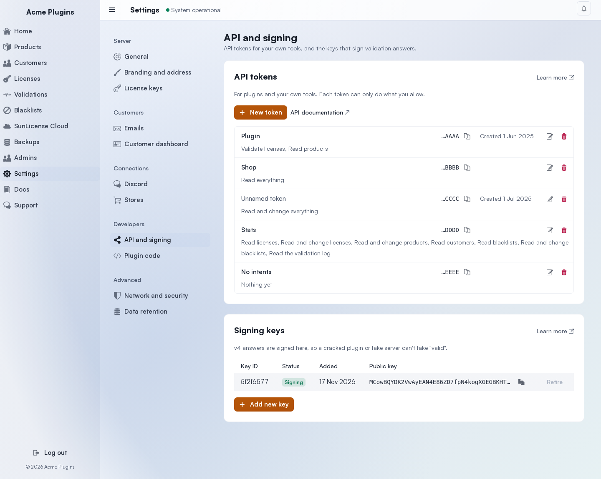

**Settings › API and signing** holds the tokens your plugins and tools use, and the keys your server signs validation answers with.

<Frame caption="Settings › API and signing">
  
</Frame>

## API tokens

Plugins and your own tools send a token with each request to the [REST API v2](/sunlicense/api-documentation/api-v2). Each token can only do what you allow.

<Steps>
  <Step title="Create a token">
    Click **New token**. Name it after the tool that uses it, so you know what breaks if you delete it.
  </Step>
  <Step title="Choose what it can do">
    Tick only what the tool needs. Plugins only need **Validate licenses**.

    | Permission | Lets the token |
    | --- | --- |
    | Validate licenses | Validate keys (what plugins need) |
    | Read licenses / Read and change licenses | List licenses, or also create and edit them |
    | Read products / Read and change products | List products, or also create and edit them |
    | Read customers | List customers |
    | Read blacklists / Read and change blacklists | List blacklist rules, or also add and remove them |
    | Read the validation log | Read the request log |
    | Read everything / Read and change everything | All of the above |
  </Step>
  <Step title="Copy it now">
    The whole token is shown once, when you create it. Copy it into your tool. Afterwards the list shows only its last characters.
  </Step>
</Steps>

You can edit a token's name and permissions later. The token itself stays the same, so tools using it keep working. Deleting a token stops every tool that uses it at once.

## Signing keys

Answers from `/api/v4/validate` are signed with your server's private key. Plugins check the signature with the public key, so a cracked plugin or a fake server can't produce a "valid" answer. The private key never leaves your server.

- Code from **Settings › Plugin code** trusts every key that isn't retired.
- Plugins and tools can read the trusted public keys from `GET /api/v4/keys` without a token.

### Rotate a key

<Steps>
  <Step title="Add a new key">
    Click **Add new key**. The new key signs every answer from now on. Plugins you already shipped keep working, because older keys stay trusted until you retire them.
  </Step>
  <Step title="Ship plugins that trust it">
    Get your plugin code again from **Settings › Plugin code**, so new builds trust the new key.
  </Step>
  <Step title="Retire the old key">
    Once every plugin you ship trusts the new key, click **Retire** on the old one.
  </Step>
</Steps>

<Warning>
  Plugins that trust only a retired key reject every answer from your server, and their buyers are locked out. Retiring can't be undone.
</Warning>
