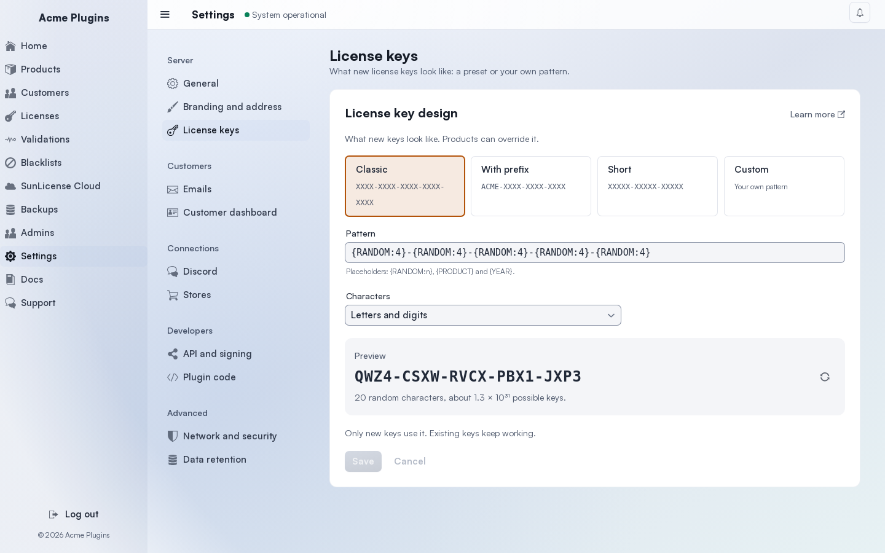
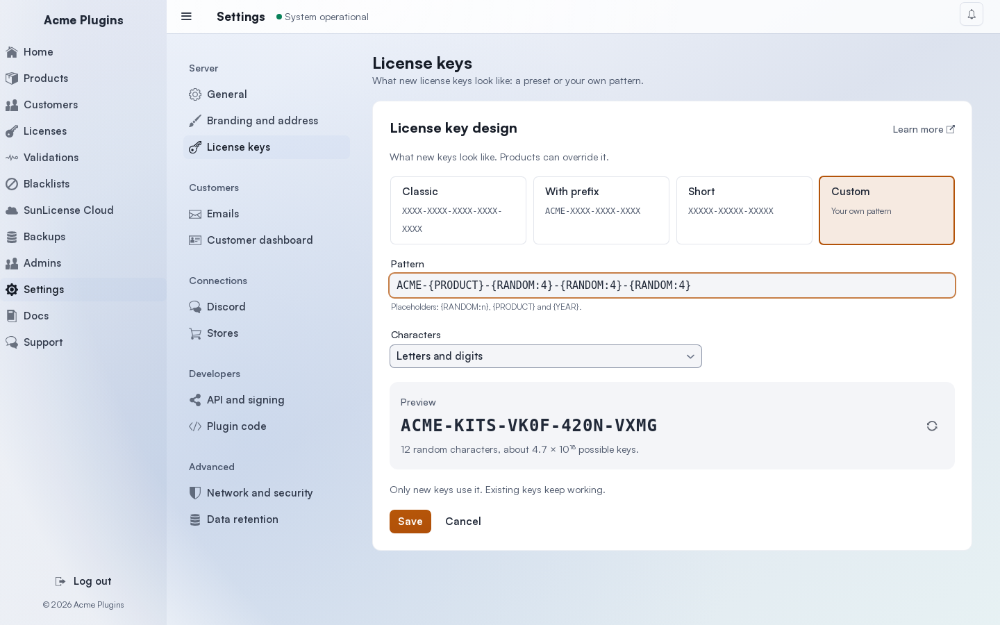
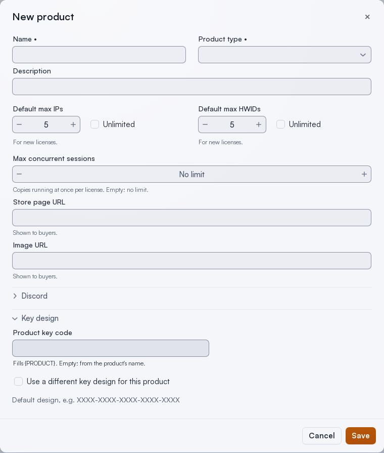

SunLicense 1.4.0 lets you choose what new license keys look like. Pick a preset, or write your own pattern with placeholders. Set a design for the whole server, and give a product its own when it needs one. Existing keys never change, and plugins and the API keep working with every design.

<Frame caption="Settings › License keys">
  
</Frame>

## Choose a design

<Steps>
  <Step title="Open the settings">
    Go to **Settings › License keys**.
  </Step>
  <Step title="Pick a preset or Custom">
    | Preset | Example |
    | --- | --- |
    | **Classic** (the default) | `XXXX-XXXX-XXXX-XXXX-XXXX` |
    | **With prefix** | `ACME-XXXX-XXXX-XXXX` |
    | **Short** | `XXXXX-XXXXX-XXXXX` |
    | **Custom** | Your own pattern |
  </Step>
  <Step title="Choose the characters">
    - **Letters and digits**: the same 36 characters as SunLicense 1.3.
    - **Letters and digits without look-alikes**: leaves out `0`, `O`, `1`, `I` and `L`, which buyers mix up when they type a key.
  </Step>
  <Step title="Check the preview and save">
    The preview shows an example key and how many keys the design can make. Click the refresh button for another example, then **Save**.
  </Step>
</Steps>

## Write your own pattern

<Frame caption="A custom pattern with a prefix, the product code and random groups.">
  
</Frame>

A pattern mixes fixed text, dashes and placeholders:

| Placeholder | Becomes |
| --- | --- |
| `{RANDOM:n}` | `n` random characters, from 1 to 32 |
| `{PRODUCT}` | The product's key code |
| `{YEAR}` | The current year |

For example, `ACME-{PRODUCT}-{RANDOM:4}-{RANDOM:4}-{RANDOM:4}` makes keys like `ACME-KITS-7QK2-M4XD-9TPA`.

Rules for a pattern:

- Use at least 12 random characters in total, so keys can't be guessed.
- Keys can be up to 64 characters long, dashes included.
- Use letters, digits, dashes and placeholders only. A dash can't start or end the key, and groups take one dash between them.

<Note>
  Dashes only group a key for reading. SunLicense stores and checks keys without them, so a buyer can type a key with or without dashes.
</Note>

## Give a product its own design

Open the product (**Products**, then the product's menu) and expand **Key design**:

- **Product key code**: what `{PRODUCT}` stands for, up to 10 letters and digits. Leave it empty to use the first letters of the product's name.
- **Use a different key design for this product**: tick it to choose a preset or pattern for this product only.

<Frame caption="The Key design section of a product.">
  
</Frame>

Settings › License keys lists the products that have their own design.

## What doesn't change

- Keys you already issued keep their format and keep validating.
- Every validation route, the REST API, the Discord bot, emails and the move to SunLicense Cloud accept keys of every design.
