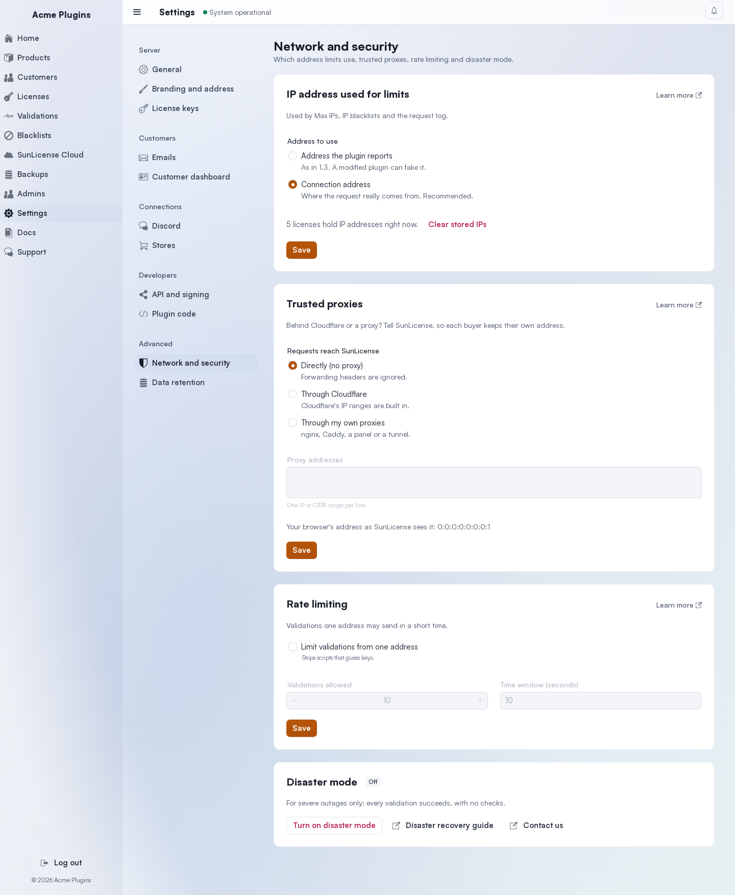

**Settings › Network and security** controls how SunLicense sees each buyer's address and how hard it is to guess keys. Check it once after you install SunLicense, especially if it runs behind Cloudflare, nginx or a hosting panel.

<Frame caption="Settings › Network and security">
  
</Frame>

## IP address used for limits

**Max IPs**, IP blacklists and the request log all use one address per validation. Choose which:

- **Connection address** (recommended): where the request really comes from. If SunLicense runs behind a proxy, also set up [trusted proxies](#trusted-proxies).
- **Address the plugin reports**: the IP the plugin puts in its request, as in SunLicense 1.3. A modified plugin can report any address, so it can get around Max IPs and IP blacklists.

The address the plugin reports is always kept in the request log too.

When you switch, licenses that already hold IP addresses may refuse new ones at their **Max IPs** limit. Click **Clear stored IPs** and each license records its addresses again from its next validations. Machines (HWIDs) are kept.

## Trusted proxies

Behind Cloudflare or a proxy, every request seems to come from the proxy. IP limits then fill at once, all buyers share one rate limit, and an IP ban hits everyone. Tell SunLicense about the proxy and it reads each buyer's address from the header the proxy adds. Requests from anywhere else can't set that header.

| Option | When |
| --- | --- |
| **Directly (no proxy)** | Plugins reach SunLicense directly. Forwarding headers are ignored. |
| **Through Cloudflare** | Your domain is proxied by Cloudflare. Cloudflare's IP ranges are built in. |
| **Through my own proxies** | nginx, Caddy, a hosting panel or a tunnel. List each proxy's IP or CIDR range, one per line, for example `127.0.0.1` or `10.0.0.0/8`. Add a line `cloudflare` to trust Cloudflare's ranges as well. |

The page shows your browser's address as SunLicense sees it, so you can check the setting works.

## Rate limiting

Limits how many validations one address can send in a short time, which stops scripts that guess keys. Over the limit, validations from that address are refused until the time window has passed.

- **Validations allowed**: per address, within the window.
- **Time window (seconds)**: 10 seconds unless you change it.

## Disaster mode

For severe outages only. While it's on, every license validation succeeds without the usual checks (HWID, IP, expiry and blacklist), so your buyers' servers keep running. Turn it off as soon as things are back to normal. See [Disaster management](/sunlicense/other/disaster-management).
