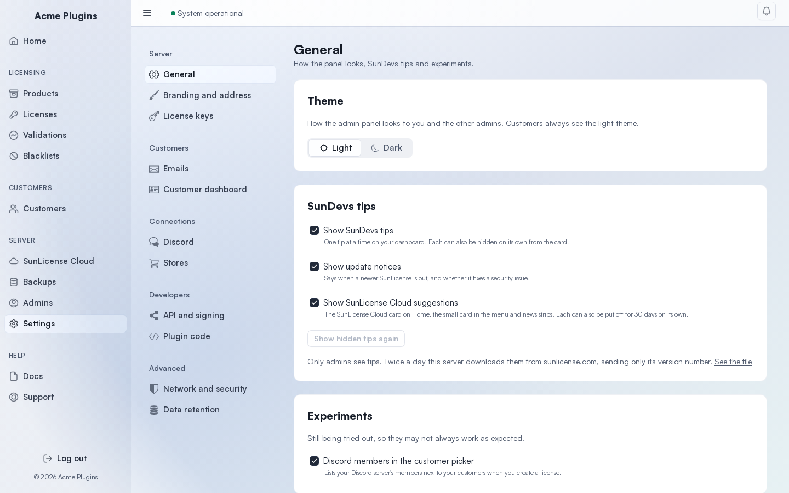
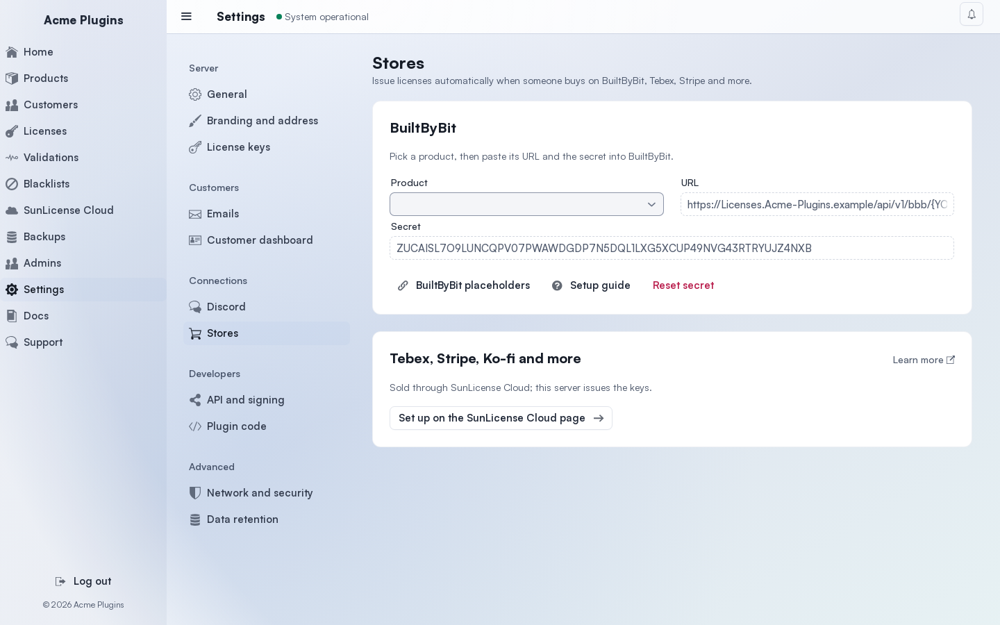

In SunLicense 1.4.0, every setting is on one **Settings** page with a grouped menu on the left. The old **Integrations** page is part of it now, and old links open the right section.

<Frame caption="Settings › General">
  
</Frame>

## Server

| Section | What it holds |
| --- | --- |
| **General** | Light or dark theme for the admin panel, SunDevs tips and update notices, SunLicense Cloud suggestions, and experiments. |
| **Branding and address** | Your app name, logo, favicon and accent colour, the public URL customers use, and your time zone for dates in emails. |
| **License keys** | What new keys look like. See [License keys](/sunlicense/dashboard/license-keys). |

## Customers

| Section | What it holds |
| --- | --- |
| **Emails** | How emails are sent (your SMTP server or SunLicense Cloud) and which emails your customers get. |
| **Customer dashboard** | What buyers can do when they sign in, and sign-in with Discord. |

## Connections

| Section | What it holds |
| --- | --- |
| **Discord** | The Discord bot, its alerts and how its messages look. See [Discord automation](/sunlicense/automations/discord-automation). |
| **Stores** | BuiltByBit's webhook URL and secret, and a link to Tebex, Stripe, Ko-fi and more through [SunLicense Cloud](/sunlicense/cloud/services#stores). |

<Frame caption="Settings › Stores">
  
</Frame>

## Developers

| Section | What it holds |
| --- | --- |
| **API and signing** | API tokens and the keys that sign `/api/v4` answers. See [API and signing](/sunlicense/dashboard/api-and-signing). |
| **Plugin code** | Ready-made validation code for your plugin, with your server's address and keys built in. |

## Advanced

| Section | What it holds |
| --- | --- |
| **Network and security** | Which IP address limits use, trusted proxies, rate limiting and disaster mode. See [Network and security](/sunlicense/dashboard/network-and-security). |
| **Data retention** | How long the request log and heartbeat sessions are kept. |

## SunDevs tips and SunLicense Cloud suggestions

Your dashboard can show one tip at a time from SunDevs, update notices, and small suggestions for SunLicense Cloud. Only admins see them, and Cloud suggestions never appear in a new install's first week. Turn each kind off under **Settings › General**, or put a single one off with **Not now**.

Some pages also show one small card about the SunLicense Cloud feature that fits that page, such as country blocking on **Blacklists**, with the Cloud plan that includes it. Click **×** on a card to hide it for 90 days. The switch under **Settings › General** turns these off too.

Twice a day your server downloads the tips from sunlicense.com, sending only its version number.
