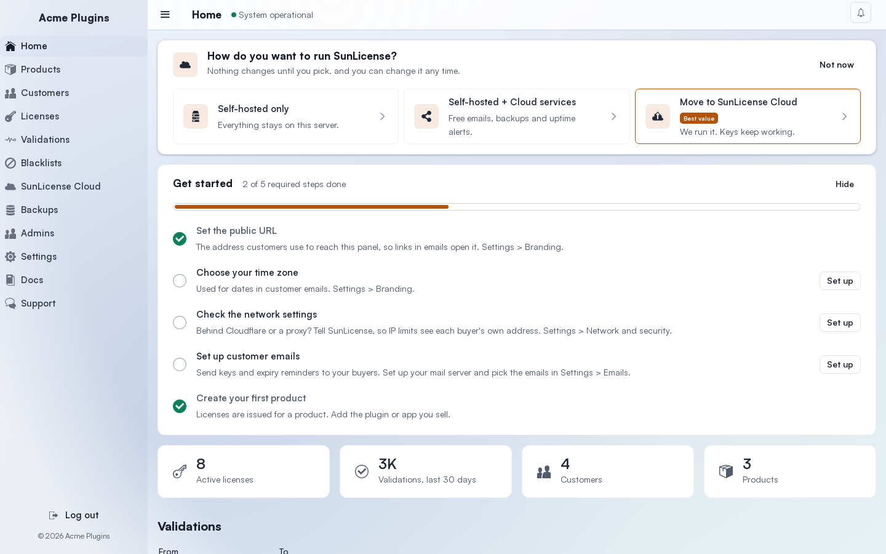
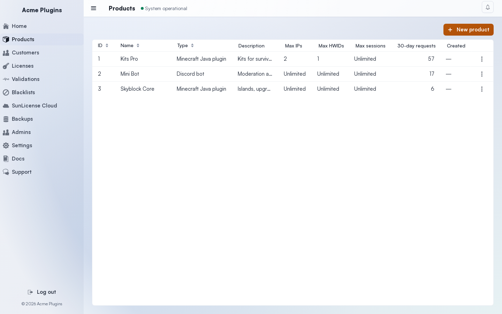
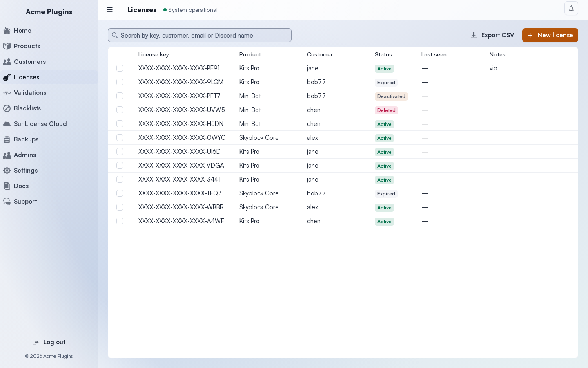
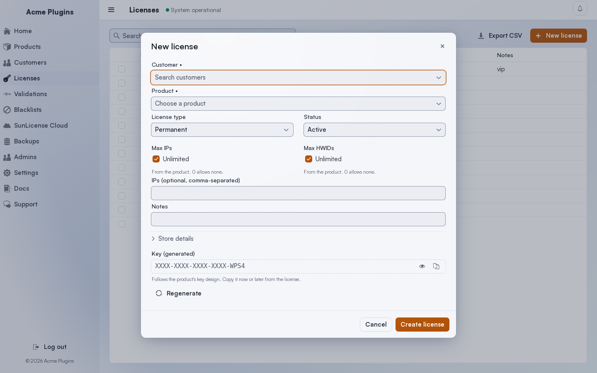
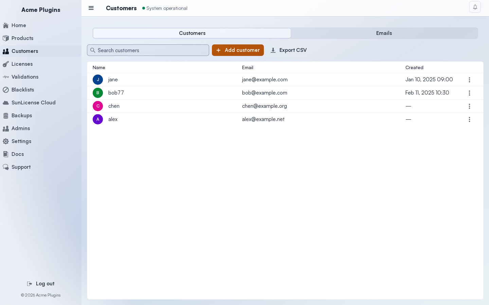
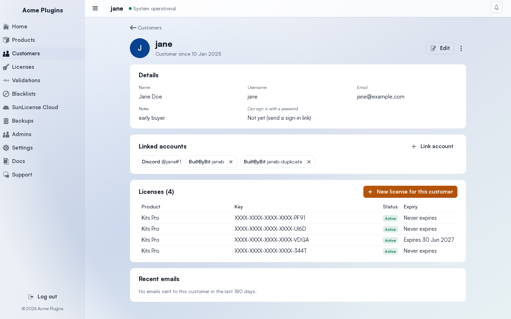
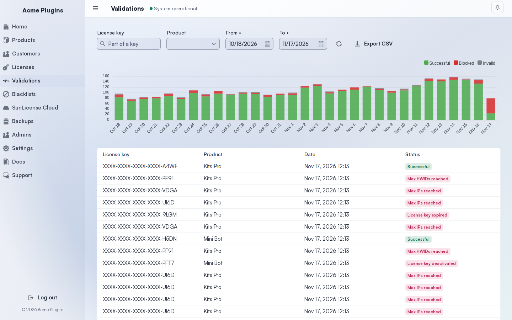
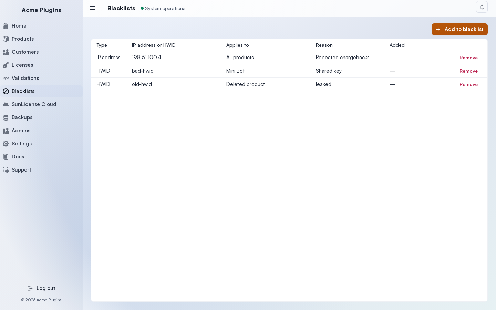
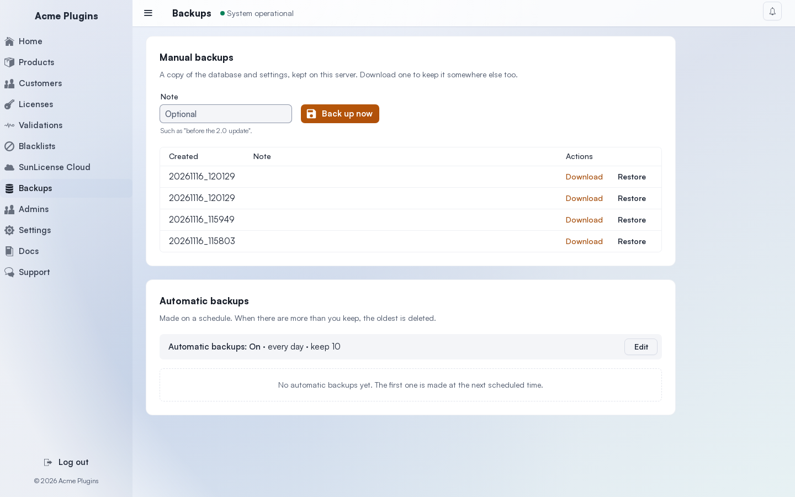

The SunLicense dashboard is where you manage products, licenses and customers. Open your server's address in a browser, for example `http://{serverip}:{port}`, and sign in with an admin account. This page walks through each part of the menu in SunLicense 1.4.0.

## Home

<Frame caption="Home on a new server">
  
</Frame>

- **How do you want to run SunLicense?** appears once, on new and upgraded servers. See [Three ways to run](/sunlicense/cloud/overview). Click **Not now** to decide later.
- **Get started** lists the steps that make a new server ready, such as setting the public URL and your time zone. **Set up** opens the right setting. **Hide** removes the list once you're done.
- The totals show active licenses, validations in the last 30 days, customers and products. Below them, a chart shows validations by day.

## Products

A product is the plugin, mod, bot or app you sell. Every license belongs to one product.

<Frame>
  
</Frame>

Click **New product** and fill in:

| Field | What it does |
| --- | --- |
| **Name** and **Product type** | Required. The type is Minecraft Java plugin, Discord bot, web application or another type. |
| **Default max IPs** / **Default max HWIDs** | How many IP addresses and machines a new license allows. Tick **Unlimited** for no limit. You can change it per license. |
| **Max concurrent sessions** | How many copies may run with one license at the same time, counted by heartbeats. Empty means no limit. |
| **Store page URL** / **Image URL** | Shown to buyers in the customer dashboard. |
| **Discord** | The roles a buyer gets when they redeem a license in your Discord server. |
| **Key design** | This product's key code, and optionally its own key design. See [License keys](/sunlicense/dashboard/license-keys). |

To edit or delete a product, use the menu at the end of its row. A product that has licenses can't be deleted.

## Licenses

<Frame>
  
</Frame>

Keys are masked, for example `XXXX-XXXX-XXXX-XXXX-PF91`. Search by key, customer, email or Discord name, and use **Export CSV** to download the list.

### Create a license

<Frame>
  
</Frame>

<Steps>
  <Step title="Click New license">
    On **Licenses**, click **New license**. From a customer's page, **New license for this customer** fills in the customer for you.
  </Step>
  <Step title="Choose the customer and product">
    Search your customers by name or email. If your Discord bot is on, members of your Discord server can appear in the list too. The product fills in the default limits.
  </Step>
  <Step title="Set the type and limits">
    **Permanent**, or a license that expires after a time or on a date. Change **Max IPs** and **Max HWIDs** if this license needs different limits.
  </Step>
  <Step title="Create it">
    The key is generated in your [key design](/sunlicense/dashboard/license-keys). Show or copy it with the buttons next to it, or click **Regenerate** for another one. Click **Create license**.
  </Step>
</Steps>

Click a license in the list to edit its owner, limits, IPs, machines or status, or to delete it.

## Customers

<Frame>
  
</Frame>

Click a customer to open their page:

<Frame>
  
</Frame>

- **Details**: name, username, email, notes, and whether they can sign in with a password. **Edit** changes them.
- **Linked accounts**: their Discord and store accounts, such as BuiltByBit. **Link account** adds one.
- **Licenses**: every license they own, and **New license for this customer**.
- **Recent emails**: what SunLicense emailed them in the last 180 days.

The **Emails** tab on **Customers** lists every email sent to customers.

## Validations

Every time a plugin checks a key, SunLicense records it here.

<Frame>
  
</Frame>

- Filter by part of a key, product and date range.
- The chart shows successful, blocked and invalid checks by day.
- Each row shows the result, for example **Successful**, **Max IPs reached** or **License key expired**. Click a row for the details the plugin sent, such as IP, HWID, operating system and Java version.

## Blacklists

Block an IP address or a machine (HWID) for all products or one product.

<Frame>
  
</Frame>

Click **Add to blacklist**, choose IP address or HWID, enter it, choose the products it applies to, and give a reason. **Remove** lifts a block.

## Backups

<Frame>
  
</Frame>

- **Manual backups**: click **Back up now** before big changes such as an update. Add a note so you know why you made it. **Download** keeps a copy somewhere else.
- **Automatic backups**: made on a schedule. **Edit** sets how often and how many to keep. When there are more than you keep, the oldest is deleted.
- **Restore** replaces everything on your server with that backup.
- With [offsite backups](/sunlicense/cloud/services#offsite-backups) on, encrypted copies kept in SunLicense Cloud are listed here too.

## Also in the menu

- **SunLicense Cloud**: how you run SunLicense, and the Cloud services. See [Three ways to run](/sunlicense/cloud/overview).
- **Admins**: the people who can sign in to the dashboard.
- **Settings**: everything else, grouped by topic. See [Settings](/sunlicense/dashboard/settings).
- **Docs** and **Support**: these docs, and the SunDevs support desk.
